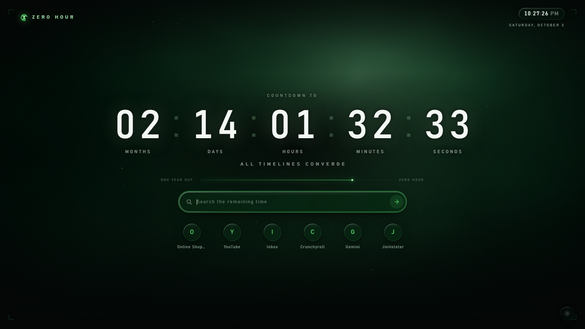

# Zero Hour — a Chrome theme and countdown new tab

A dark, cathedral-green browser skin with a cinematic countdown on every new tab,
built on a translucent glass material that refracts the backdrop behind it.

**Get it:** [Zero theme on the Chrome Web Store](https://chromewebstore.google.com/detail/kbgnjhikolnmknhibojckjfanfdbapak).
The countdown extension and the other themes are in review.
[Privacy policy](docs/store/PRIVACY.md): nothing is collected or transmitted.

Every image it ships — backdrop, surfaces, icons — is generated procedurally by
code in this repo. Nothing is traced, imported or derived from existing artwork,
which is what makes it safe to publish.

The backdrop is swappable if you want your own: drop an image in
`ai_generated_images/` and run `node tools/adopt-images.mjs`. Keep that local.
`.gitignore` excludes it for a reason — `tools/verify.mjs` only checks *text* for
studio and franchise names and cannot inspect what is inside an image, and
publishing someone else's artwork is an infringement issue whether or not you
charge for it.



## Two packages, and why

Chrome does not let one package do both jobs. A **theme** repaints the browser
frame but cannot run code; an **extension** can replace the new tab but cannot
repaint the frame. So this repo ships both, designed against the same palette:

| Folder | Installs as | Covers |
| --- | --- | --- |
| `themes/<palette>/` | Theme | Window frame, active and inactive tabs, toolbar, bookmarks bar, omnibox, toolbar icons, new-tab fallback |
| `extension/` | Extension | The new tab page, its settings, the toolbar popup, and an optional accent on ordinary web pages |

**A theme cannot change colour at runtime.** Its values are fixed in its own
`manifest.json`, there is no API to alter them, and an extension cannot modify
another installed package. Nor can several themes share one listing — a theme
package holds exactly one set of colours.

So there are four theme folders, one per palette: `themes/zero`, `themes/ember`
and `themes/astra` match the extension's palettes exactly, and `themes/neutral`
is a graphite frame that sits correctly under all of them. Each one is its own
store listing.

Install both for the full effect. Either works alone.

## Installing

Both are unpacked folders, so no build step is needed.

1. Open `chrome://extensions`.
2. Turn on **Developer mode** (top right).
3. Click **Load unpacked** and choose the `extension` folder.
4. Click **Load unpacked** again and choose one of `themes/zero`, `themes/ember`
   or `themes/astra`. Chrome allows one active theme, so pick the one matching
   the palette you set in the extension's settings.

Chrome will ask to confirm the theme. To go back, use **Reset to default** in
`chrome://settings/appearance`.

To produce `.zip` files for the Chrome Web Store instead, run `node tools/build.mjs`.
To make a `.crx` you can drag-install, use **Pack extension** on `chrome://extensions`.

## Settings

Click the hourglass in the toolbar, or the gear at the bottom right of the new tab.

- **Date and time** — the countdown target. Pre-set to 18 December 2026; change it to anything.
- **Title**, **tagline**, and the **message shown when the clock runs out**.
- Toggles for the clock, search bar, shortcut tiles, cinematic bars, and motion.
- **Shortcuts** — leave empty to use your most-visited sites, or list your own.
- **Accent on web pages** — carries the green onto scrollbars, text selection and
  form controls across the sites you visit.

Settings sync through your Chrome profile and apply to open tabs immediately.

They are stored in `chrome.storage.sync`, so they travel to every device signed
in to the same profile, the same way Chrome carries bookmarks and open tabs.
That requires Chrome sync to be on and extension syncing enabled; with it off,
the same code stores everything locally and nothing is lost — it simply stays on
that machine.

Writes are coalesced: sync storage caps how often it accepts them (120 a minute)
and replicates each one to every device, so edits are merged and written once you
pause rather than once per keystroke.

## The glass

Every surface in the extension — the search pill, shortcut chips, popup, settings
cards and fields — is built from one material in `extension/css/glass.css`, in
the vein of the translucent glass Apple and vivo have both moved to. Four layers
make it read as glass rather than a tinted panel:

1. `backdrop-filter` blurs and saturates whatever sits behind it, so the backdrop
   genuinely refracts through the surface instead of being hidden by it.
2. A **specular rim** — a gradient-filled border masked down to a 1px ring, near-white
   where light lands and cooling into the accent as it wraps away. A plain border
   cannot vary its colour around a shape, which is why it is done with a mask.
3. An **inner lens**: light pooling under the top edge, with a faint accent bounce
   off the floor.
4. Inset highlight and shade plus a cast shadow, so panels float rather than sit flat.

Interactive surfaces brighten, catch more rim light and give slightly under a press.
Add the look to anything with `class="glass"`, `glass--tap` if it is clickable, and
`glass-field` for `<input>` — which cannot carry pseudo-elements, so it gets the
same material with fewer layers. Tune the whole system from the `--glass-*` tokens
at the top of that file.

One honest limit: this applies to the **extension's** pages. Chrome themes cannot
do translucency or blur — the frame, tabs and toolbar accept flat colours and
tiled images only, so the glass stops at the browser chrome.

## What Chrome will not let this reach

Worth knowing before you go looking for it:

- **`chrome://` pages** — settings, history, downloads, the extensions page. Neither
  themes nor extensions may style them. They follow Chrome's own dark mode.
- **Native menus** — the right-click menu, the three-dot menu, print and file dialogs.
  These are drawn by the operating system.
- **The tab strip shape** — tab corners and the frame layout are fixed; only colours
  and background images are themeable.

Everything Chrome does expose is themed here.

## Permissions, and why each one is asked for

The default install asks for nothing that touches your browsing.

| Permission | Why | When |
| --- | --- | --- |
| `storage` | Keeps your settings | Always |
| `search` | Sends the search box to *your* default engine, not a hardcoded one | Always |
| `favicon` | Draws real site icons on the shortcut tiles | Always |
| `scripting` | Registers the optional web-page accent | Always |
| `topSites` | Your most-visited sites on the tiles | Only if you tap "Show my most-visited sites" |
| Website access | The optional accent on ordinary pages | Only if you turn that switch on; turning it off revokes it |

## The artwork

Every image is drawn by `tools/gen-assets.mjs` unless you replace it.

The backdrop comes in two styles. `soft` is the default: light and atmosphere
only, with no structure that could read as a mark. `cathedral` is a stained-glass
scene with a lancet window:

```
node tools/gen-assets.mjs            # soft
node tools/gen-assets.mjs cathedral  # stained glass
```
The scene is a Voronoi stained-glass field behind a round-headed cathedral window,
lit by a single hard shaft, with lead came, rib highlights, foreground beams, a
vignette and film grain. The icon is a fractured hourglass inside a broken ring.

### Palettes

Three ship: **Zero** (green), **Ember** (crimson to gold) and **Astra** (gilded
white). All three are dark-based on purpose — the countdown is white type sitting
directly on the backdrop, so what changes is the hue of the light and the glass,
not the darkness under it.

They are defined once, in `tools/palette.mjs`. The generator renders a backdrop
and a sigil for each, and writes three files that must never be hand-edited:

- `extension/css/palettes.css` — every colour token, as hex and as `r g b`
  triples so stylesheets can vary alpha per use
- `extension/js/palettes.js` — the list the settings picker is built from
- `extension/css/web-accent-<key>.css` — the opt-in page accent, which has to
  carry literal colours because it is injected where our tokens do not exist

Adding a fourth palette is one entry in `tools/palette.mjs` plus a regenerate.

### Replacing the artwork with your own

Generated or hand-made images can take the place of the procedural ones. Put them
in `ai_generated_images/` and run `node tools/adopt-images.mjs` — it fits each
file to the exact size the packages need, writes it into place, backs up what it
replaced, and reports whether the backdrop is dark enough for the countdown to
read against it.

`ai_generated_images/PROMPTS.md` has prompts written to the layout's constraints,
which images to leave procedural and why, and how to judge a result.

### Adjusting the procedural art

Change the palette in `tools/palette.mjs` and re-run:

```
node tools/gen-assets.mjs
```

That also rewrites each `themes/<palette>/manifest.json`, so the theme colours
never drift from the extension's. `extension/css/tokens.css` is the one place a
colour change has to be mirrored by hand.

## Scripts

| Command | What it does |
| --- | --- |
| `node tools/gen-assets.mjs` | Redraws every PNG in `themes/*/images` and `extension/assets`, and the theme manifests |
| `node tools/test-countdown.mjs` | Tests the countdown maths, including month-length edge cases |
| `node tools/test-accent-sync.mjs` | Tests the web-accent registration, including the concurrent-listener race |
| `node tools/test-settings-writes.mjs` | Tests that settings writes are coalesced before reaching sync storage |
| `node tools/verify.mjs` | Checks both manifests, every referenced file, the CSP rules and permissions |
| `node tools/build.mjs` | Verifies, then writes store-ready zips to `dist/` |
| `node tools/promo.mjs` | Renders the 440x280 store promo tiles as 24-bit PNG (no alpha) |
| `node tools/release.mjs` | Runs every check, then assembles `release/v<version>/` for submission |
| `node tools/adopt-images.mjs` | Fits images from `ai_generated_images/` into both packages |
| `node tools/shoot.mjs newtab 1600 900` | Screenshots a page through headless Chrome, for design work |

`tools/` and `dist/` are not part of either package.

## Layout

```
themes/         one browser theme per palette
  zero/ ember/ astra/ neutral/
    manifest.json
    images/     generated surfaces
extension/      the new tab extension
  manifest.json
  newtab.html   popup.html   options.html
  css/          tokens.css is the palette; the rest are per-page
  js/           countdown.js is pure logic and has tests
  assets/       generated artwork and icons
tools/          generators, tests, checks — not shipped
docs/store/     store listing copy, screenshots, promo tiles, privacy policy
ai_generated_images/
                drop replacement artwork here; PROMPTS.md explains what to make
```

### A note on the countdown

Months are not a fixed number of milliseconds, so `js/countdown.js` counts whole
calendar months first and divides only the remainder into days, hours, minutes and
seconds. That is why "2 months 16 days" agrees with a calendar, and why
`tools/test-countdown.mjs` checks that 31 January plus one month lands on 28
February rather than 3 March.

## License

[MIT](LICENSE).
